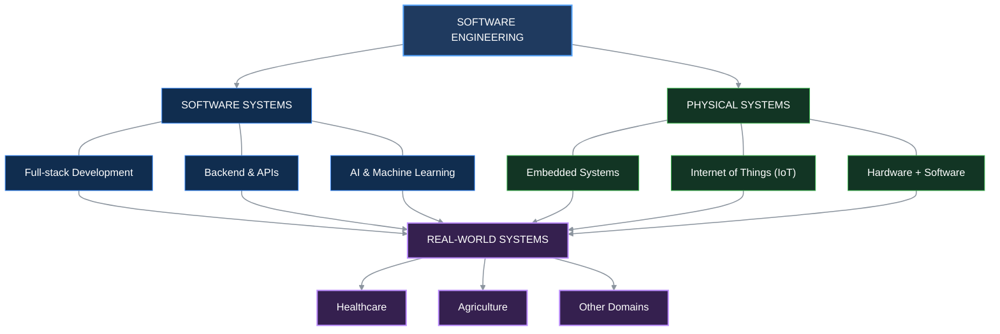

# Otete Benjamin Agogo

### Software Engineer | Full-stack Development · AI · Connected Systems

**Engineering | AI | Healthcare**

> Building software, intelligent systems, and connected technology to solve real-world problems.

I’m developing across the software and physical sides of engineering — from full-stack applications and backend systems to artificial intelligence, embedded systems, and the Internet of Things (IoT).

<p align="left">
  
  
  
  
</p>

---

[Explore My Projects](#featured-projects) · [My Engineering Journey](#engineering-journey) · [Connect With Me](#connect)

 Building software, intelligent systems, and connected technology to solve real-world problems.


                                          

## Engineering Direction



## About Me

I'm a software engineer focused on understanding how complete systems are designed, built, and connected.

My engineering journey is centered around full-stack development, while progressively expanding into artificial intelligence, embedded systems, and the Internet of Things.

I don't want to build technology in isolation. I want to understand how software interacts with people, data, devices, and the physical world.

With a background in healthcare, I have a particular interest in using technology to improve healthcare systems. I'm also interested in agriculture and other real-world domains where software, AI, embedded systems, and IoT can create meaningful solutions.

My long-term goal is to become an engineer capable of taking a real-world problem, understanding the system behind it, and building the technology required to solve it — from the user interface and backend to intelligent models, connected devices, and physical systems.

```
```
## What I'm Building

I'm building my engineering capabilities through practical projects that progressively connect software, data, AI, and eventually physical systems.

### 🛡️ Real-World Software

Building applications that address practical problems rather than stopping at programming exercises.

### 🌐 Full-Stack Systems

Learning to design and build complete applications across the frontend, backend, APIs, databases, and deployment.

### 🤖 Intelligent Systems

Exploring how artificial intelligence can be integrated into useful software and real-world systems.

### ⚙️ Embedded Systems & IoT

My longer-term direction is to connect software with the physical world through embedded systems, sensors, devices, and IoT.

### 🏥 Technology for Impact

Applying my healthcare background to identify problems where technology can improve processes, accessibility, decision-making, and outcomes — while remaining open to other domains such as agriculture.


---
---

# Technology Stack

*Tools and technologies I use to build, test, and understand software systems.*

### Languages


### Web & Backend Engineering


### Data & Infrastructure


---
### Exploring

AI / Machine Learning · Embedded Systems · IoT

---

## Featured Projects

*Selected projects demonstrating my approach to software engineering and real-world problem-solving.*

<table>
  <tr>
    <td width="50%" valign="top">
      <h3>💰 Personal Finance Tracking System</h3>
      <p>A software engineering project focused on organizing personal financial records, managing expenses, and building reliable application functionality.</p>
      <p><strong>Focus areas</strong></p>
      <p>Application Architecture · Data Management · API Development</p>
      <p><a href="https://github.com/benjaminagogo1/software-engineering-laboratory">View Repository →</a></p>
    </td>
    <td width="50%" valign="top">
      <h3>📄 PDF Report Generator</h3>
      <p>A backend report-generation service that transforms database data into multi-page PDF reports through FastAPI, SQL aggregation, and headless Chromium.</p>
      <p><strong>Technologies</strong></p>
      <p>Python · FastAPI · SQL · Chromium</p>
      <p><a href="https://github.com/benjaminagogo1/Pdf-Report-Generator">View Repository →</a></p>
    </td>
  </tr>
  <tr>
    <td colspan="2" valign="top">
      <h3>🌱 Agro-Shield</h3>
      <p>A collaborative agricultural technology project intended to address real-world challenges in the agricultural ecosystem.</p>
      <p><strong>Focus area</strong></p>
      <p>Agricultural Technology · Collaborative Engineering</p>
      <p><a href="https://github.com/etoosammy01-oss/Agro-Shield">View Team Repository →</a></p>
    </td>
  </tr>
</table>

---


---

## Engineering Journey

My learning path is intentional: I am building a strong software engineering foundation first, then progressively expanding into intelligent and connected systems.

```text
SOFTWARE ENGINEERING
        │
        ▼
FULL-STACK DEVELOPMENT
        │
        ▼
SYSTEMS & APIs
        │
        ▼
ARTIFICIAL INTELLIGENCE
        │
        ▼
EMBEDDED SYSTEMS
        │
        ▼
IoT & CONNECTED DEVICES
        │
        ▼
INTELLIGENT REAL-WORLD SYSTEMS

```
---

## Currently Exploring

- 🧩 Deepening my full-stack engineering skills
- 🤖 Exploring Artificial Intelligence and Machine Learning
- ⚙️ Preparing to move into embedded systems
- 📡 Learning how software connects with physical devices through IoT
- 🏥 Exploring opportunities to apply technology to healthcare
- 🌱 Exploring technology-driven solutions for agriculture


---

## Engineering Philosophy

I believe good engineering starts with understanding the problem before choosing the technology.

I focus on building from first principles, understanding how systems work internally, and turning complex problems into smaller, testable components.

I'm interested not only in writing code, but in understanding how software interacts with data, networks, devices, people, and the physical world.

My goal is to build systems that are useful, reliable, understandable, and capable of solving real problems at scale.


---

## GitHub Activity

<p align="center">
   <br>
   
</p>


---

## Connect

I'm always interested in learning, building, collaborating, and connecting with other people working on interesting technology.

# Connect

<p align="left">
  <a href="https://github.com/benjaminagogo1">
    
  </a>
  <a href="http://www.linkedin.com/in/otete-benjamin-agogo-03861b210">
    
  </a>
  <a href="https://www.facebook.com/profile.php?id=61573088355413">
    
  </a>
</p>
